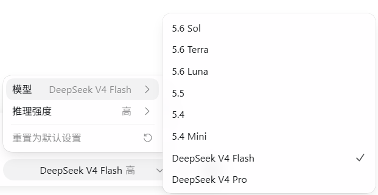

[English](./README.en.md) | 中文

# codex-gateway

Windows 本地网关，让 Codex 在同一模型菜单中使用官方 ChatGPT 订阅和 DeepSeek API。按请求中的模型名路由；官方请求使用 Codex 的 OAuth 登录态，DeepSeek 请求使用你保存的 API Key。

支持在同一对话中切换官方与 DeepSeek 模型。网关自动适配请求，原始会话历史保持完整。



## 快速开始

普通用户可在 [Releases](https://github.com/Yuanzhe-Dong/codex-gateway/releases/latest) 下载 Windows 压缩包，解压后双击 `codex-gateway 控制台.bat`，按以下步骤使用：

1. 选择 **4 配置向导**，输入 DeepSeek API Key，按提示选择模型及网络模式。
2. 选择 **1 启动网关**，看到启动成功后，完全退出并重新打开 Codex。
3. 在 Codex 的模型菜单中选择官方模型或 DeepSeek。网关启动后可以关闭控制台。

控制台只保留启动、停止、状态、配置、重启、卸载六项日常操作。更换程序或网络设置后选择 **5 重启网关**；仅遇到权限不足时才通过 Windows 系统提示重试。停止和卸载均保留 Codex 对话历史。

从源码构建需要 Rust 1.89 或更新版本，以及 Windows C++ 编译工具：

```powershell
cargo build --release --locked
.\target\release\codex-gateway.exe setup
.\target\release\codex-gateway.exe start
```

如果使用发布压缩包，解压后直接运行同目录的 `codex-gateway.exe` 或双击 `codex-gateway 控制台.bat`。程序和 `assets/`、控制台脚本保持在同一目录。

`setup` 保存网关配置、备份原始 Codex 配置并生成模型目录；`start` 确认服务已经监听并通过健康检查后才接管 Codex。首次接管及恢复原始 provider 后，需要完全退出并重新打开 Codex。网关运行时，在模型菜单内切换官方 / DeepSeek 通常不需要重启任务。

## 命令

| 命令 | 功能 |
| --- | --- |
| `setup` | 输入 API Key，选择模型、端口及网络模式；重新配置前先 `stop` |
| `start` | 后台启动并激活网关配置；失败返回非零错误码 |
| `start --foreground` | 在前台运行；Ctrl+C 退出后恢复配置 |
| `stop` | 只停止当前数据目录对应的实例，恢复安装前的 provider |
| `restart` | 停止旧实例并用当前程序重新启动，保留网关设置和原始会话历史 |
| `status` | 检查进程身份、本地服务、配置和外网 HTTP 可达性 |
| `status --offline` | 只检查本地状态，不访问外网 |
| `uninstall` | 恢复配置，删除网关密钥、日志、模型目录和原始配置备份 |

模型目录刷新、接口测试、日志和只读会话检查见 [诊断与维护](./docs/DIAGNOSTICS.md)。这些工具不出现在日常控制台中。

`stop` 保留网关设置，之后可再次 `start`。`uninstall` 后需要重新 `setup`。两者都不删除会话历史；已有的会话修复备份及用于并发协调的空锁文件会保留。

## 路由与模型

```text
Codex → 127.0.0.1:17899
          ├─ deepseek-* → api.deepseek.com
          └─ 其它模型  → chatgpt.com/backend-api/codex
```

两边使用 Responses API，网关保留 SSE 流并做必要的请求兼容处理。它不将 ChatGPT 订阅转换为 OpenAI API 额度。使用前仍需在 Codex 中完成官方登录，并在 [DeepSeek 平台](https://platform.deepseek.com) 创建 API Key。

GPT-6.1 Terra（`gpt-6.1-terra`）已适配。合并目录会补充已知 6.x 选项，即使原生缓存只返回 5.6；同名账号元数据优先，隐藏模型不会被重新显示。菜单选项不代表账号授权，实际调用仍由官方后端决定。启动时会尝试更新超过一天的官方目录。

默认模型为 `deepseek-flash` 和 `deepseek-v4-pro`。[2026-10-17 发布的 V4.1-Flash-1017](https://api-docs.deepseek.com/news/news261017/) 继续使用 `deepseek-flash`，不应把日期拼入 API 模型名。两个退役别名 `deepseek-v4-flash` / `deepseek-v4-flash-vision-exp` 在配置、目录和请求中统一映射到当前 Flash。推理档位为 `none / low / high / xhigh`，其中 `xhigh` 与从官方模型带入的 `ultra` 转为 DeepSeek 的 `max`；`minimal → low`、`medium → high`。发往 DeepSeek 时移除官方专用的 `service_tier`，官方请求的加速档位原样保留。Flash 支持图片输入，Pro 保留文本输入；依据 [DeepSeek Responses 文档](https://api-docs.deepseek.com/api/create-response/)核对，日期为 2026-10-17。

官方目录可运行 `refresh-models` 按当前登录账号在线获取。账号快照保留原始元数据；生成目录副本补齐必需字段，并保留账号公布的 `max/ultra` 档位（0.4.0 面向当前客户端；旧客户端需先升级）。结果独立保存为 `CODEX_HOME/codex-gateway-official-models.json`，不改写原生缓存或登录信息；每次 `setup/start` 会把它与原生 `models_cache.json` 合并，同名模型采用较新来源的元数据，较新的“推荐集”缓存也不会再遮住另一来源里的 GPT-6 等前沿模型。刷新失败不覆盖已有目录，也不会切换 provider。该命令即使尚未输入 DeepSeek Key 也可使用；OAuth 失效时需要在 Codex 中重新登录，不自动刷新或改写令牌。

缓存都不可用时使用有限内置清单；缓存可用时补充其中缺少的已知 6.x 模型（包括 GPT-6.1 Sol、GPT-6.1 Terra、GPT-6 Astra、GPT-6 Sol、GPT-6 Luna），模型能力按 [GPT-6.1 Sol](https://developers.openai.com/api/docs/models/gpt-6.1-sol)、[GPT-6 Astra](https://developers.openai.com/api/docs/models/gpt-6-astra)、[GPT-6 Sol](https://developers.openai.com/api/docs/models/gpt-6-sol) 和 [GPT-6 Luna](https://developers.openai.com/api/docs/models/gpt-6-luna) 文档核对（2026-10-17）。内置清单不是账号授权证明，实际 Codex 上下文及模型权限以在线账号目录为准。

DeepSeek 支持的工具和内容类型与官方接口有差异，服务端 `responses/compact` 不受支持，内置搜索等工具也不能仅靠合并目录获得。详情见 [DeepSeek 兼容性说明](https://api-docs.deepseek.com/guides/responses_api/)。官方后端及 Codex 的模型缓存、会话数据库格式属于外部兼容边界，客户端更新后仍需实际验证。

本项目控制本地 Codex 后端。桌面端的远程托管会话拥有独立的配置和模型目录，本地网关无法修改它们；不能承诺所有工作模式都有相同模型菜单。验证范围见 [0.4.0 验证记录](./docs/REFACTOR-0.4.0.md)。

## 配置、恢复与历史

- 网关数据默认在 `%USERPROFILE%\.codex-gateway`，可由 `CODEX_GATEWAY_HOME` 指定便携目录。
- Codex 数据默认在 `%USERPROFILE%\.codex`，优先使用 `CODEX_HOME`。
- 一个网关数据目录绑定一个 Codex 数据目录，不能更改 `CODEX_HOME` 后沿用另一份原始备份。不同 Codex 数据目录可使用独立的 `CODEX_GATEWAY_HOME`；同一个 Codex 数据目录应只启用一份网关配置。
- 原生用户保留 `openai` 身份，已安装网关的用户保留 `codex_gateway` 身份；通过 `openai_base_url` 和专用别名切换连接地址。第三方 provider 用户启用时使用网关别名，停止时恢复原 provider。恢复仅处理网关拥有的字段，保留新增 MCP、项目和第三方配置。
- 网关配置和原始配置备份在写入密钥前限制为当前用户访问；配置内容仍是本机明文。不要共享或提交网关数据目录。
- 0.4.0 完全移除了 SQLite 写入。`start/stop/restart` 不迁移任何会话记录，不重写 JSONL。停止和卸载后保留指向官方直连的 `codex_gateway` 身份，避免新客户端拒绝恢复已有网关会话。
- 旧版网关配置可自动迁移；原始配置备份和已有会话备份继续保留。
- 官方请求副本移除第三方推理，保留用户/助手正文、工具调用和官方有效推理密文；DS 请求副本保留明文推理，仅摘掉 DS 文档不支持的 `encrypted_content`，原文件不变。
- 启动时保留当前官方模型选择；新客户端恢复历史要求 provider 身份匹配，旧版留下的混合身份不会被自动改写。`status --offline` 显示历史兼容是否实际启用；网关日志只记录过滤数量，不记录历史正文。停止网关恢复官方直连后，这层适配不再运行。

网关配置、状态、PID 和模型目录使用同目录临时文件替换，避免写入中断后留下半份文件。启动失败时保留原始 Codex 配置；进程停止失败时返回错误，不继续清除网关数据。

## 网络与本地访问

手动代理优先于自动检测；自动模式在启动时读取环境代理和 Windows WinINET 设置（支持 `http=…;https=…`）。切换代理设置后重启网关使其生效。强制直连确实禁用环境/系统代理；手动代理失败时不会绕过代理。只有自动代理发生连接阶段错误时才直连重试一次，读取超时和上游 HTTP 错误不重发请求。

网关只监听 IPv4 回环地址，拒绝浏览器跨站请求和非回环 Host，业务请求要求 Bearer 登录头。发往 DeepSeek 的头使用白名单，避免泄漏官方账号信息；自动 HTTP 重定向禁用。此机制不隔离同一 Windows 用户运行的其它本地程序，Bearer 头存在检查不等于验证官方 OAuth 的真实性。

仅提供 `/responses`、官方 `/responses/compact`、`/models` 和 `/healthz`，同时兼容 `/v1` 前缀。请求体上限为 64 MiB，同时最多 8 个请求；读取客户端请求体超时 30 秒，建立上游连接超时 10 秒，上游连续 10 分钟无数据则结束等待。SSE 有持续数据时不会因固定总时长而截断。日志在启动时超过 10 MiB 会轮换一次，运行中不会实时轮换。设置 `RUST_LOG=debug` 可查看输入结构，但不会记录输入文本或完整凭证。

## 控制台与快捷方式

```powershell
powershell -NoProfile -ExecutionPolicy Bypass -File "安装到开始菜单.ps1"
powershell -NoProfile -ExecutionPolicy Bypass -File "安装到开始菜单.ps1" -Remove
```

开始菜单提供控制台和启动、停止、重启入口。重新运行安装脚本会移除旧版诊断入口，保留用户自行添加的文件。快捷方式支持源码目录和便携发布包；单次操作窗口保留结果供查看。批处理启动器是纯 ASCII，PowerShell 脚本带 UTF-8 BOM，适配 Windows PowerShell 5.1。

## 验证与审查

```powershell
cargo fmt --all -- --check
cargo test --locked
cargo clippy --locked --all-targets -- -D warnings
powershell -NoProfile -ExecutionPolicy Bypass -File tests/console.ps1
```

测试使用本地模拟上游及临时 Codex 数据目录，不需要真实 API Key，也不产生模型请求费用。真实程序测试覆盖启动/停止/卸载、前台模式、端口占用、PID 丢失与复用、配置迁移、历史备份和多实例隔离。

结构与维护入口见 [项目架构](./docs/ARCHITECTURE.md)，本次验证和限制见 [0.4.0 重构记录](./docs/REFACTOR-0.4.0.md)。

## License

MIT
