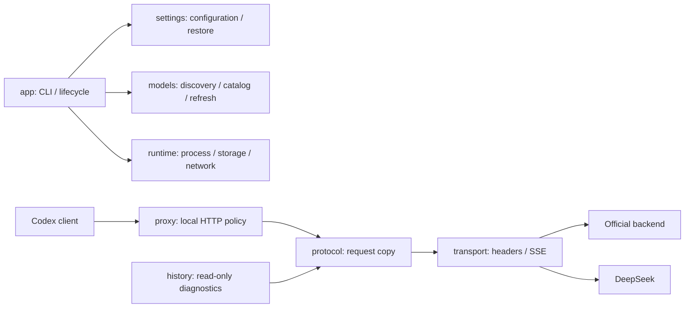

# 项目架构（0.4.0）

目标：Codex 在同一对话中切换官方订阅和 DeepSeek；协议兼容只发生在请求副本，不修改会话或登录态。

| 目录 | 职责和入口 | 不应承担的工作 |
| --- | --- | --- |
| `src/main.rs` | 入口、错误退出码 | 业务配置与协议转换 |
| `src/app/` | `cli.rs` 参数解析；`lifecycle.rs` 启停、预检与锁；向导、状态 | 直接修改历史 |
| `src/settings/` | `gateway.rs` 私有设置；`codex.rs` 配置备份、按字段合并、恢复 | 模型请求、数据库迁移 |
| `src/models/` | `client.rs` 运行时发现；`catalog.rs` 目录合并；`refresh.rs` 账号刷新、DS 探测 | 修改登录令牌或选定模型 |
| `src/proxy/` | `mod.rs` 路径/本地访问/限流；`routing.rs` 模型路由；`protocol.rs` 请求副本；`transport.rs` 认证头和 SSE | 保存原始消息、修改会话 |
| `src/runtime/` | 网络代理、路径、原子私有写入、Windows 进程身份和锁 | 决定会话 provider 归属 |
| `src/history.rs` | 只读检查最新压缩后的历史、验证两种请求副本 | SQLite/JSONL 写入 |

## 关键约定

1. provider 是会话身份。原生 `openai` 和已安装的 `codex_gateway` 保持不变；地址决定是否经过网关。第三方 provider 的启动/恢复保持原先配置语义。
2. 原始账号目录保留完整元数据；生成的目录补齐客户端必需字段。菜单不是授权证明。
3. 未知协议项原样保留，只清理已证实不兼容的推理/工具字段。官方 OAuth 不转交 DeepSeek，工具调用与结果的关联 ID 同步转换。
4. 请求只在连接失败且启用自动代理时允许一次直连重试；HTTP 错误、读取超时、已经收到的流不得重放。
5. 停止进程前核对可执行路径和创建时间。配置恢复只覆盖本工具拥有的字段；进程健康确认后才激活地址。
6. 项目不依赖 `.codex/`。它仅保存测试运行数据、快照、临时文件；源码、正式测试和文档均在外部。

## 维护入口

- 改协议：`src/proxy/protocol.rs` 的单元回归 + `src/proxy/tests.rs` 的真实回环 HTTP/SSE 回归。
- 改配置/启停：`tests/cli.rs` + `tests/desktop_compat.py`（须指定真实 Codex 可执行文件）。
- 改菜单：`src/models/catalog.rs` 回归 + 真实客户端 `model/list`。
- 改控制台：Windows PowerShell 5.1 运行 `tests/console.ps1`，保留主脚本 UTF-8 BOM。
- 在线检查需显式调用 `tests/live_smoke.py --live` 或 `test-deepseek`；它们不属于离线测试，产生正常模型用量。

当前验收证据与保留限制见 [重构记录](REFACTOR-0.4.0.md)。
